# Konserin

Website informasi jadwal konser musik lokal maupun internasional di Indonesia. Project ini dikembangkan untuk memenuhi tugas perkuliahan **Bab 9 – NestJS Dasar + Struktur MVC** dengan menghubungkan frontend React + Vite ke backend REST API NestJS.

## Fitur Utama

- **Jadwal Konser Dinamis:** Mengambil data dari REST API NestJS (`GET /concerts`), lengkap dengan ringkasan statistik, pencarian konser, filter kategori (`Lokal` / `Internasional`), filter status tiket, serta pengurutan berdasarkan tanggal/harga.
- **Tambah Konser (`POST /concerts`):** Menambahkan jadwal konser baru dengan validasi input DTO.
- **Kelola Konser (`PATCH /concerts/:id` & `DELETE /concerts/:id`):** Mengubah detail konser dan menghapus konser dengan dialog konfirmasi terlebih dahulu.
- **Error Handling & Validasi:** Menggunakan `ValidationPipe` global (`class-validator`), `NotFoundException` (`404`), dan `ConflictException` (`409`).

## Teknologi yang Digunakan

### Frontend (`konserin-frontend/`)
- React.js (`^19.3.1`)
- Vite (`^8.3.4`)
- JavaScript (Fetch API)
- CSS Murni

### Backend (`backend/`)
- NestJS (`^12.0.1`)
- TypeScript
- `class-validator` & `class-transformer`
- `@nestjs/mapped-types`
- Penyimpanan data sementara menggunakan array di dalam Service (tanpa database)

## Struktur Project

```text
Project_Fullstack/
├── konserin-frontend/         # Frontend React + Vite
│   ├── src/
│   │   ├── assets/
│   │   ├── components/
│   │   │   ├── ConcertCard.jsx
│   │   │   ├── ConcertForm.jsx
│   │   │   ├── ConcertList.jsx
│   │   │   ├── ConcertManageSection.jsx
│   │   │   ├── HeroSection.jsx
│   │   │   └── Navbar.jsx
│   │   ├── App.jsx
│   │   └── App.css
│   └── package.json
│
├── backend/                   # Backend NestJS (MVC)
│   ├── src/
│   │   ├── concerts/
│   │   │   ├── dto/
│   │   │   │   ├── create-concert.dto.ts
│   │   │   │   └── update-concert.dto.ts
│   │   │   ├── entities/
│   │   │   │   └── concert.entity.ts
│   │   │   ├── concerts.controller.ts
│   │   │   ├── concerts.service.ts
│   │   │   └── concerts.module.ts
│   │   ├── app.module.ts
│   │   └── main.ts
│   ├── concerts.http          # File pengujian REST Client
│   └── package.json
│
├── docs/
│   └── screenshots/           # Dokumentasi screenshot setiap tahapan
│
├── .gitignore
├── package.json               # Script root untuk menjalankan backend + frontend sekaligus
└── README.md
```

## Cara Menjalankan Aplikasi

### Opsi 1: Jalankan Sekaligus dari Root (`Project_Fullstack`)
```bash
npm run dev
```
Perintah ini menjalankan backend (`http://localhost:3000`) dan frontend (`http://localhost:5173`) secara bersamaan dalam satu terminal.

### Opsi 2: Jalankan Terpisah

#### 1. Menjalankan Backend (NestJS)
```bash
cd backend
npm install
npm run start:dev
```
Backend berjalan di `http://localhost:3000`.

#### 2. Menjalankan Frontend (React + Vite)
Buka terminal baru:
```bash
cd konserin-frontend
npm install
npm run dev
```
Frontend berjalan di `http://localhost:5173`.

## Daftar Endpoint REST API (`/concerts`)

| Method | Endpoint | Fungsi |
|---|---|---|
| `GET` | `/concerts` | Mengambil seluruh data konser |
| `GET` | `/concerts/:id` | Mengambil detail konser berdasarkan ID |
| `POST` | `/concerts` | Menambahkan konser baru |
| `PATCH` | `/concerts/:id` | Mengubah data konser berdasarkan ID |
| `DELETE` | `/concerts/:id` | Menghapus data konser berdasarkan ID |

## Pengujian REST Client

File pengujian tersedia di [`backend/concerts.http`](backend/concerts.http). Buka file tersebut di VS Code (dengan ekstensi **REST Client**) lalu klik **Send Request** pada setiap skenario untuk menguji CRUD dan error handling (`400`, `404`, `409`).

## Dokumentasi Screenshot

### 1. Struktur Project Backend NestJS
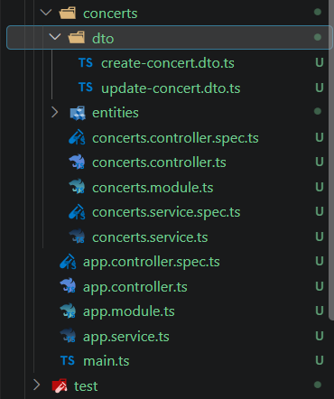

### 2. Pembuatan Resource Menggunakan Nest CLI (`nest g resource concerts`)
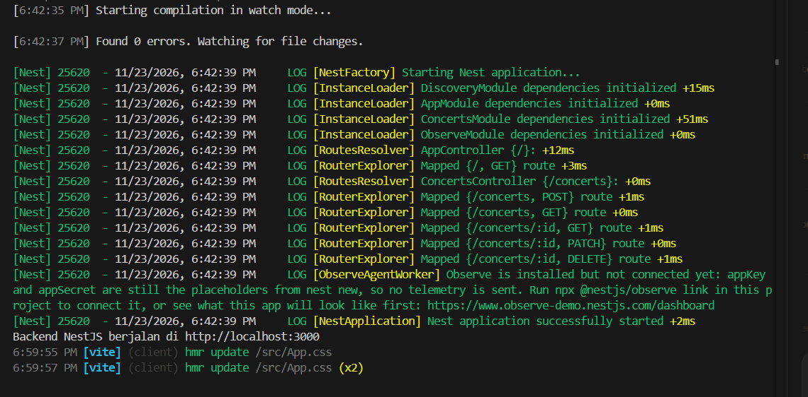

### 3. Implementasi Entity dan DTO
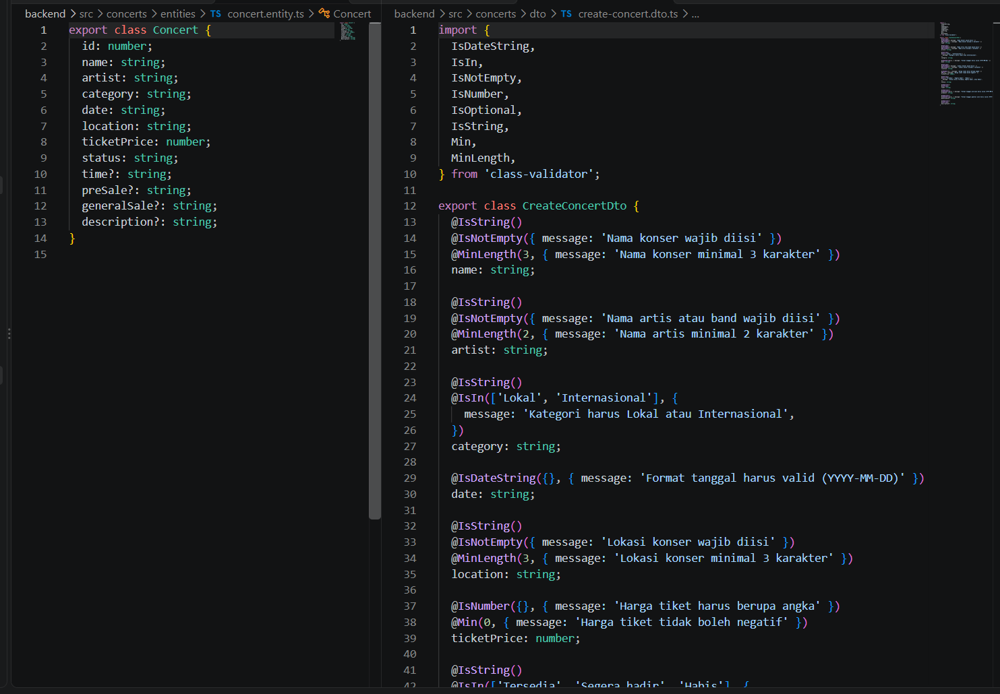

### 4. Implementasi Service dan Controller
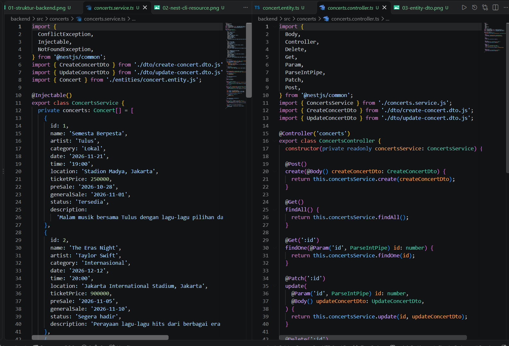

### 5. Validasi DTO dan `ValidationPipe` (`main.ts`)
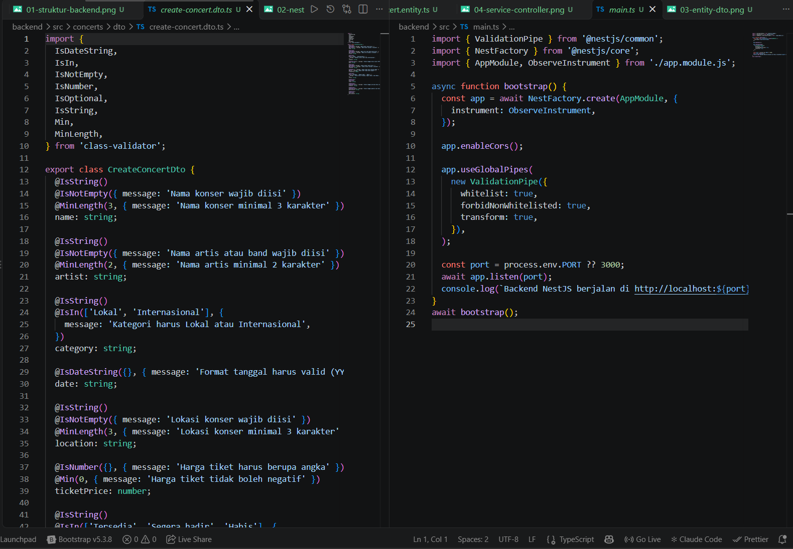

### 6. Pengujian `GET`, `POST`, `PATCH`, dan `DELETE` melalui POSTMAN
- **GET Konser**
  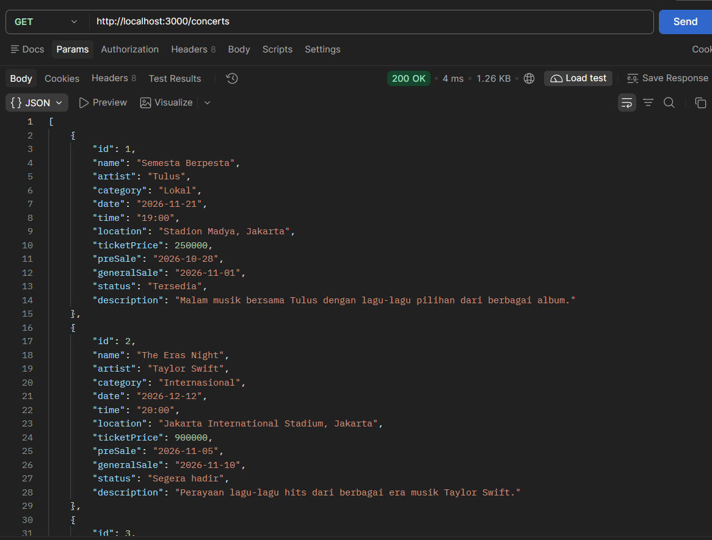
- **POST Tambah Konser**
  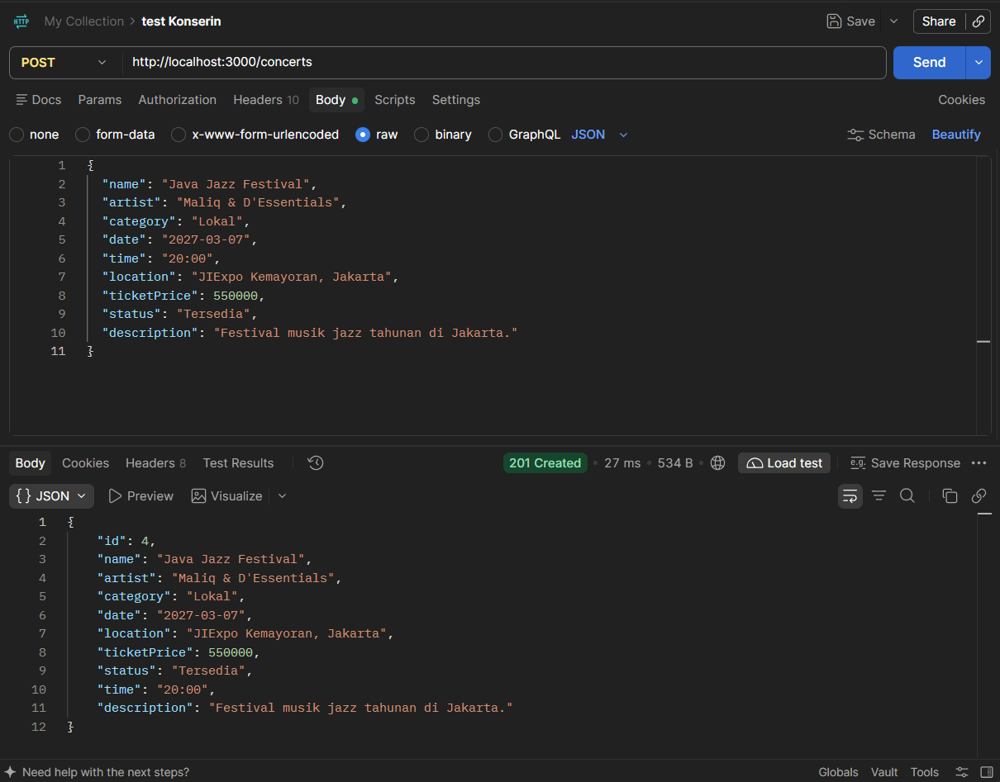
- **PATCH Ubah Konser**
  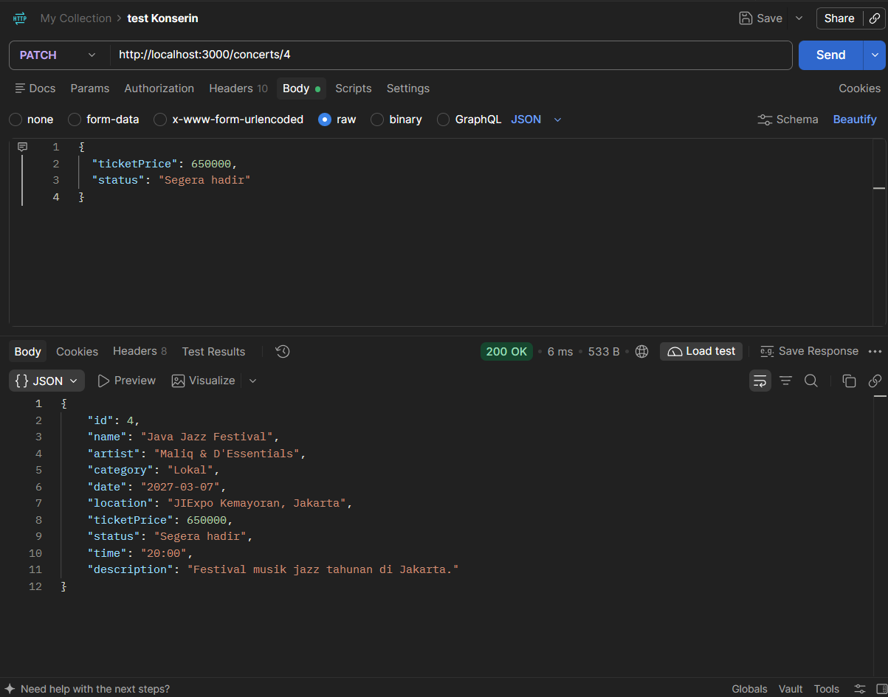
- **DELETE Hapus Konser**
  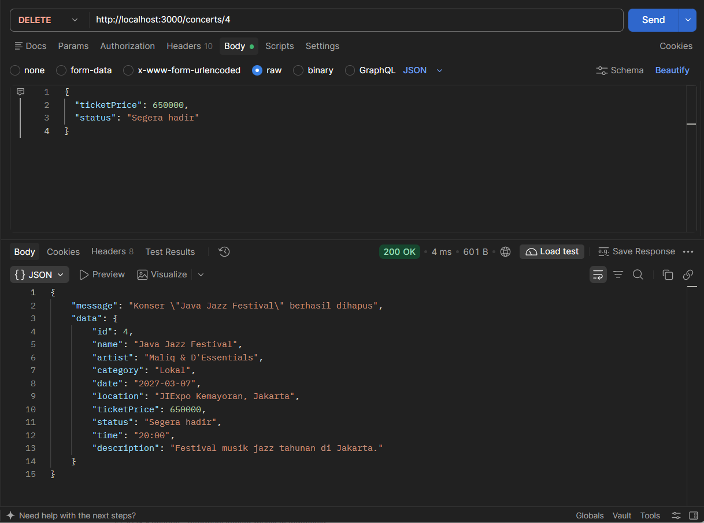

### 7. Pengujian Error Handling (`400`, `404`, `409`)
- **400 Bad Request (Validasi DTO)**
  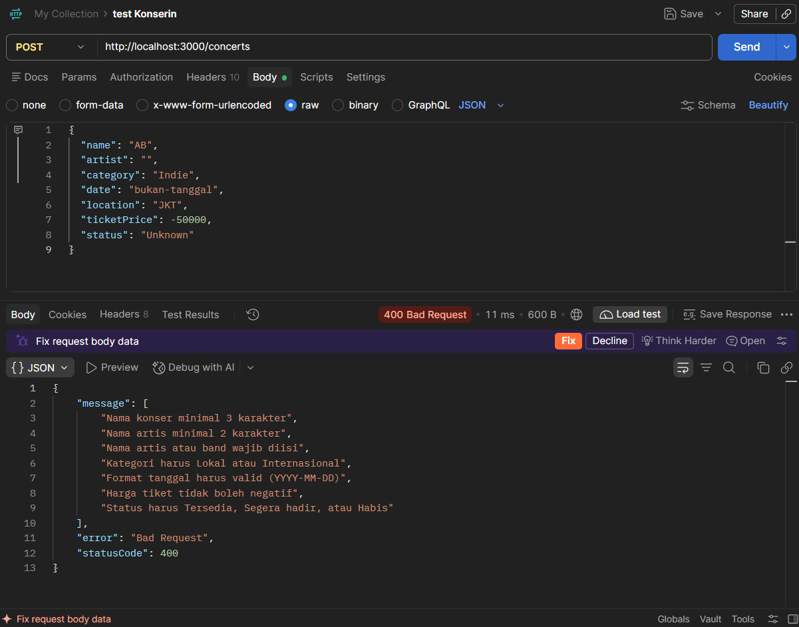
- **404 Not Found (`NotFoundException`)**
  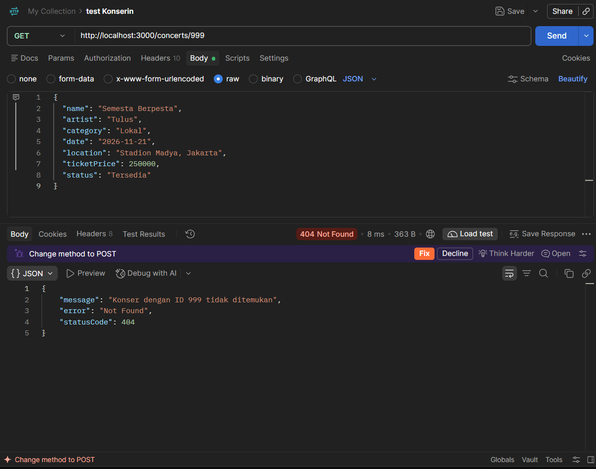
- **409 Conflict (`ConflictException`)**
  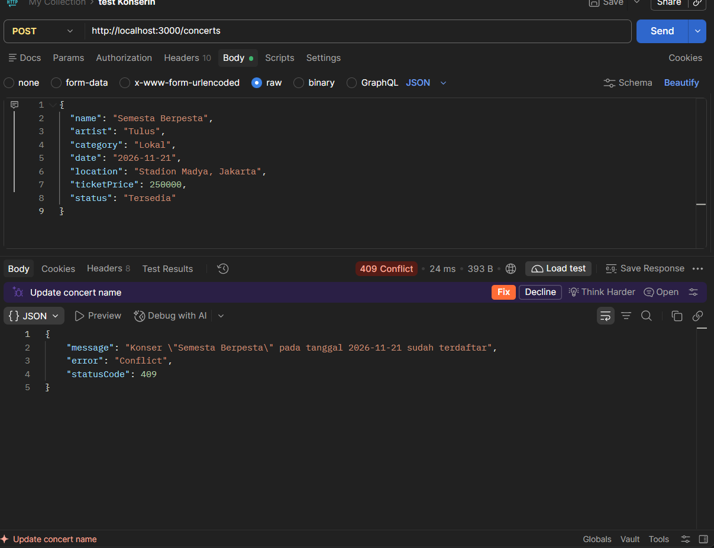

### 8. Hasil Integrasi Frontend dengan Backend
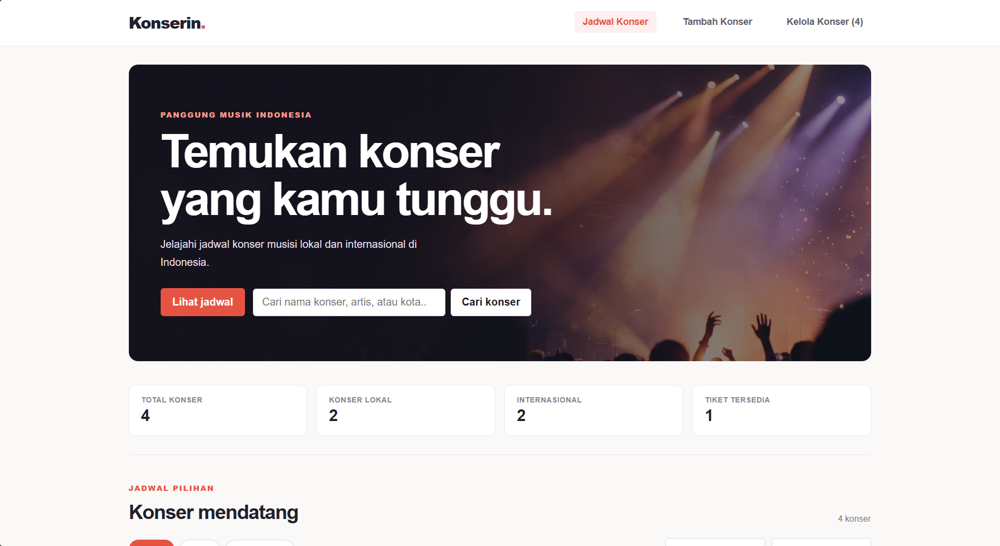

### 9. Bukti Fitur Tambah, Ubah, dan Hapus Data Konser
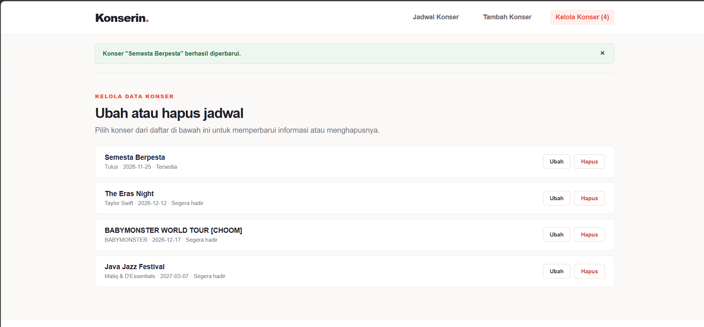
